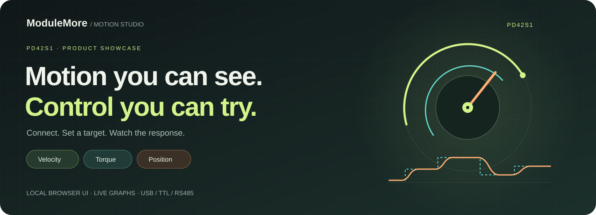
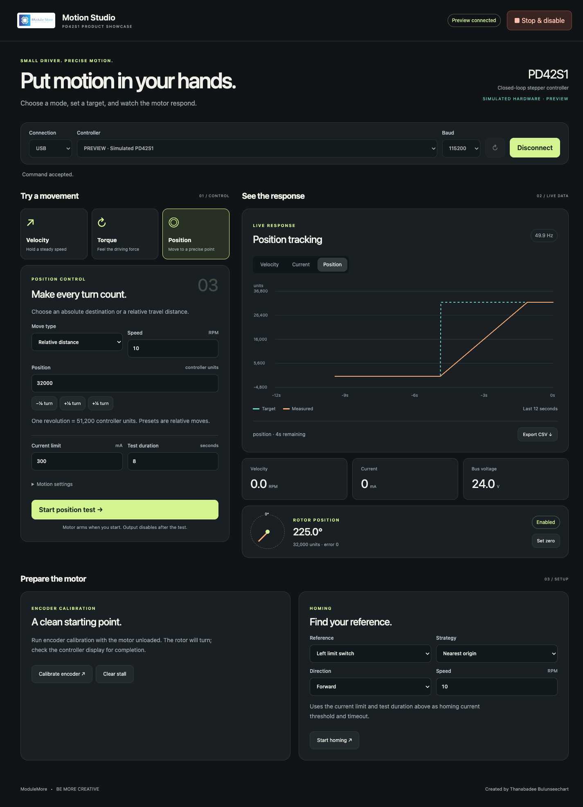
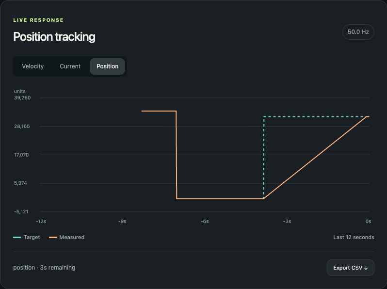
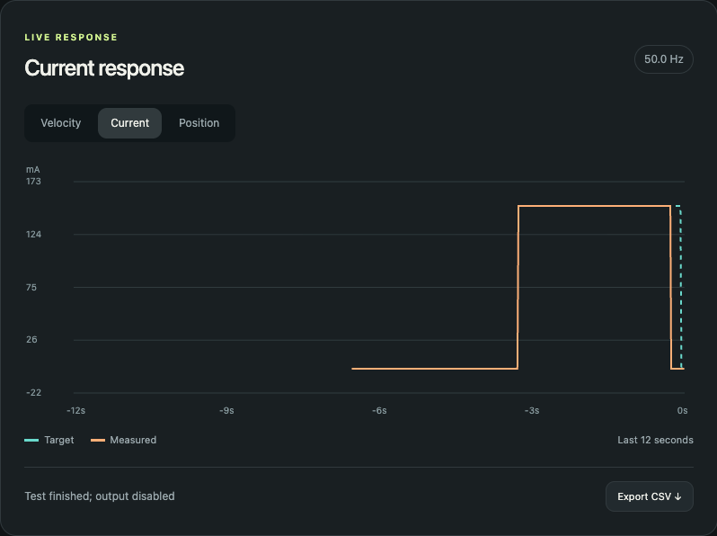

# ModuleMore Motion Studio — PD42S1 Showcase

English · [ภาษาไทย](README.th.md)

[](https://www.modulemore.com/product/2932/pd42s1-foc-closed-loop-stepper-driver-rs485)

A focused product demonstration app for the PD42S1 closed-loop stepper controller: velocity, current-based torque, position, calibration, homing, and live graphs in a local browser. The application interface is English; installation and usage documentation is available in English and Thai.

**Product:** [PD42S1 FOC Closed-loop Stepper Driver RS485 — ModuleMore](https://www.modulemore.com/product/2932/pd42s1-foc-closed-loop-stepper-driver-rs485).

**Try the interface before connecting a motor.** Explore three motion modes, watch targets and responses, and export your results—all in a local browser. No frontend build required.

[View the driver / buy at ModuleMore](https://www.modulemore.com/product/2932/pd42s1-foc-closed-loop-stepper-driver-rs485) · [Install and try](#installation-guide) · [Learn the controls](#usage-guide)

## See it in action



*Actual application screenshot captured in preview mode. The simulated rotor follows a relative position command; this is an interface demonstration, not a hardware performance measurement.*

### Watch the command and response

| Position tracking | Current response |
| --- | --- |
|  |  |
| See a destination and the rotor's travel toward it. | Explore current-based torque commands and timed disable. |

*Both graph captures use the built-in simulator. Real-motor response depends on the motor, load, supply, tuning, and communication link. The banner's rotor and trace are decorative illustrations.*

- **Three modes, one workspace:** velocity, current-based torque, and absolute/relative position.
- **See what's happening:** target/measured traces, rotor angle, current, voltage, and achieved telemetry rate.
- **Easy experiments:** presets, timed tests, zeroing, calibration, homing, and CSV export.
- **Start without hardware:** preview mode never opens a serial device. Connect a real driver when your wiring and mechanism are ready.

After following the installation guide, start the hardware-free demonstration:

```sh
python -m showcase --preview
```

Open the local browser page and click **Connect controller** with the `PREVIEW` device selected. To use a real PD42S1, stop that server and launch without `--preview`.

## Installation guide

### Requirements

- Python 3.10 or newer, with `pip` and virtual-environment support.
- A current web browser. The interface runs locally; no frontend build or Node.js installation is needed to use it.
- Git, this repository, and the [`pd42s1-motor` Python library](https://github.com/fxprime/pd42s1-motor). The instructions below put the two repositories in sibling folders. If your library is elsewhere, replace `../pd42s1-motor` with its actual path.
- For real operation: a powered PD42S1, compatible motor, and USB connection or the appropriate USB-to-TTL/RS485 adapter. Check the product documentation for power, wiring, and motor compatibility.

### macOS / Linux

From your preferred projects directory, clone both repositories and install:

```sh
git clone https://github.com/fxprime/pd42s1-motor.git
git clone https://github.com/fxprime/Motion-Studio-Stepper.git
cd Motion-Studio-Stepper
python3 -m venv .venv
source .venv/bin/activate
python -m pip install --upgrade pip
python -m pip install -e ../pd42s1-motor
python -m pip install -e .
pd42s1-showcase
```

### Windows (PowerShell)

From your preferred projects directory, open PowerShell. Activation is not required with these commands:

```powershell
git clone https://github.com/fxprime/pd42s1-motor.git
git clone https://github.com/fxprime/Motion-Studio-Stepper.git
cd Motion-Studio-Stepper
py -3 -m venv .venv
.\.venv\Scripts\python.exe -m pip install --upgrade pip
.\.venv\Scripts\python.exe -m pip install -e ..\pd42s1-motor
.\.venv\Scripts\python.exe -m pip install -e .
.\.venv\Scripts\python.exe -m showcase
```

### Launch after installation

Open [Motion Studio](http://127.0.0.1:8422). The app normally opens your browser automatically. Keep the terminal running; use `Ctrl+C` to shut down normally.

On macOS, you can also double-click `run.command` for real hardware or `preview.command` for simulation. Both use this folder's `.venv`.

On macOS/Linux, a later terminal session can start the app without activating the environment:

```sh
./.venv/bin/python -m showcase
```

On Windows, use `.\.venv\Scripts\python.exe -m showcase`.

### Preview without hardware

For a demonstration without a controller:

```sh
pd42s1-showcase --preview
```

Click **Connect controller** using the `PREVIEW` device. Preview never opens a serial port and is explicitly labeled simulated hardware. It demonstrates the UI, not the physical behavior of a real motor.

The same `--preview` option works with `python -m showcase`. Stop the preview server before starting real-hardware mode on the same port. Plugging in hardware does not turn a preview server into a real-hardware server.

Optional launch settings:

```sh
python -m showcase --port 8423 --no-browser
```

This changes the URL to `http://127.0.0.1:8423` and prevents automatic browser opening.

## Usage guide

### Connect and run your first test

1. Connect power and USB, TTL UART, or RS485. Select the serial device, matching baud rate, and RS485 address if applicable. Close/disconnect the engineering app first: only one app can own the controller's port.
2. Start with an unloaded rotor and the default 300 mA current limit, 30 RPM speed, and five-second duration. These are starting values, not a guarantee of safety for every mechanism.
3. Choose **Velocity**, **Torque**, or **Position**, set a target, and press **Start test**. Confirm the motion dialog.
4. Inspect the live graph, measured speed/current/voltage, and rotor angle. Switch graph tabs or export the last 12 seconds as CSV.
5. Every timed motion test stops and requests verified disable after 1–30 seconds. **Stop & disable** is always available. Disconnect also stops and disables first.

The telemetry service targets 50 Hz; the badge displays the actual achieved rate. Serial speed, controller firmware, and transport latency determine the real-hardware rate.

### Velocity control

Select **Velocity**, enter a signed speed in RPM, and choose the current limit and test duration. For a cautious first test, try 10 RPM and one second with a current limit appropriate for your motor. Click **Start velocity test**, check the confirmation, and keep the mechanism clear. Negative RPM reverses direction. Use the presets or **Reverse** for another test.

### Torque control

Select **Torque** and enter the signed current command in mA. Its magnitude must not exceed **Current limit**. Start with a low value and a short duration. Torque mode does **not** regulate speed: an unloaded rotor can accelerate rapidly even at low current. Be ready to stop, and use an independent physical cutoff where necessary. The graph shows measured current, not measured mechanical torque.

### Position control and zero

Select **Position** and choose **Relative distance** or **Absolute position**. Relative values move from the current position; absolute values use the controller's coordinate origin and must be nonnegative. Set the travel speed and duration, then start the test. The turn presets always select relative moves.

One revolution is 51,200 controller units; 3,200 units is 1/16 turn and 6,400 units is 1/8 turn. **Set zero** stops/disables first and makes the current position the new origin for subsequent absolute commands. It does not search for a switch or a physical home reference.

The output disables when the duration expires, even if the move has not reached its target. Choose a duration suitable for the travel distance; inspect the measured position and error rather than treating the timer as a position-completion indicator.

### Calibration and homing

Use **Calibrate encoder** only with the mechanical load removed and the rotor free to turn. Confirm the warning, then wait for completion on the controller display. A successful command response only means the request was acknowledged.

For **Homing**, verify the physical limit switch or sensorless stop first. Choose the reference, strategy, direction, and search speed. The current limit and duration fields above supply the configured current threshold and timeout. Confirm the setup before starting. A timeout or disabled output does not prove homing succeeded; verify the resulting reference before position tests.

### Graphs, stopping, and disconnecting

Switch between **Velocity**, **Current**, and **Position** graph tabs. The graph shows the last 12 seconds; **Export CSV** saves those samples. The rotor indicator wraps the angle for display while the position readout retains controller units.

Press **Stop & disable** to interrupt a test. Check for disabled read-back and investigate any reported failure. Use **Disconnect** when finished; it stops and disables before closing the serial port. If changing between preview and real hardware or restarting the server, refresh the browser to reconnect the live telemetry stream.

## Included controls

| Control | Meaning |
| --- | --- |
| Velocity | Signed RPM; negative values reverse direction. Presets and Reverse shortcut. |
| Torque | Signed current command in mA, not measured N·m. Torque depends on motor constants and operating conditions. Magnitude must not exceed the selected current limit. |
| Position | Absolute destination or signed relative distance; speed and acceleration settings. 51,200 controller units per revolution; relative turn presets. |
| Set zero | Stops/disables first, then assigns the present position as the coordinate origin. Not physical homing. |
| Calibration | Requests encoder calibration after a warning about unloaded rotation. Command acknowledgement is not calibration completion: check the driver's LCD before another operation. |
| Homing | Left/right limit switch or sensorless stop, search direction, and single-revolution / nearest-origin / multi-turn-zero strategy. Requires the corresponding physical reference and correct configuration. |
| Clear stall | Clears the latched stall state after stopping/disabling; remove the cause first. |

Position and homing tests are bounded by the chosen duration. A test ending does **not** prove the target/origin was reached. Long travel can require a longer duration or a shorter test distance. Homing uses the current limit field as its configured current threshold and duration as its controller timeout. The showcase does not currently poll homing-completion register `0x96`.

## Safety and limits

- Keep the mechanism clear before confirming any motion or calibration. Confirm direction and limit-switch wiring before homing.
- Enable/disable reuse the engineering app's read-back verification and communication-mode recovery. A failed verification is displayed as an error, not a successful state change.
- The timers run in the Python server, not the browser, so closing the tab does not cancel the motion timeout. There is also a 60-second idle-disable setting from the shared core.
- Software stop is not a physical emergency stop. Loss of communication, power, or a crashed server can prevent a disable command; use an independent power cutoff where required.
- Motion commands temporarily configure the controller current limit; homing configures timeout/reference parameters. The app does not issue a flash-save command. Review settings in the engineering app when returning to normal use.
- The server binds only to `127.0.0.1`. Do not expose it publicly; this local tool has no authentication.

Advanced PID tuning, raw frames, pulse-width/open-loop modes, and full parameter editing are outside this showcase's scope. The separate engineering app is not bundled in this repository.

## Troubleshooting

| Symptom | Check |
| --- | --- |
| Missing module or command | Use this app's `.venv` Python and repeat both editable-install commands. Confirm the motor library folder exists. |
| No serial device | Check power, cable/adapter, OS serial permissions/drivers, then use **Refresh devices**. USB charging-only cables will not work. |
| Port busy or connection fails | Disconnect other serial tools, especially `pd42s1_mdm`; verify device and baud. RS485 additionally needs matching address and correct A/B/common-ground wiring. |
| Still says simulated hardware | Stop the server and launch without `--preview`, then refresh the page. |
| Graphs stop after restart | Refresh the browser. Confirm the controller remains connected and check the achieved telemetry rate. |
| Enable/disable read-back fails | Stop testing and use a physical cutoff if needed. Inspect controller state, wiring, firmware, and communication configuration in the engineering app. Do not assume the output changed. |
| Position test stops short | Check current limit, speed, load, position error, and duration. A timed stop is not a completed move. |
| Address already in use | Stop the existing server or select another `--port`; open its corresponding URL. |

## Development and CodeGraph

```sh
python -m unittest discover -s tests -v
codegraph index .
```

Generated environments and CodeGraph indexes are ignored by Git. If you use CodeGraph, initialize the local index after cloning with `codegraph init -i .`; use the project-specific path when querying it. CodeGraph is optional and is not needed to run the app.

`showcase/server.py` contains the focused API, validated command-frame builders, timed tests, and isolated preview motor. `showcase/web/` contains the dependency-free UI and canvas graph. `core.py`, `telemetry.py`, `transport.py`, and `modbus.py` are an intentional local snapshot of the engineering app's tested communication implementation; changes in one repository do not automatically update the other.

Native protocol source: PD42S1 user manual V1.2, commands `0x01`, `0x64`, `0x91`–`0x95`, `0xF0`–`0xF3`, and `0xF8`, plus the existing engineering enable/disable compatibility implementation. Consult the controller manual and product documentation for full wiring and protocol details.

Created by **Thanabadee Bulunseechart** · **ModuleMore — Be More Creative**.
